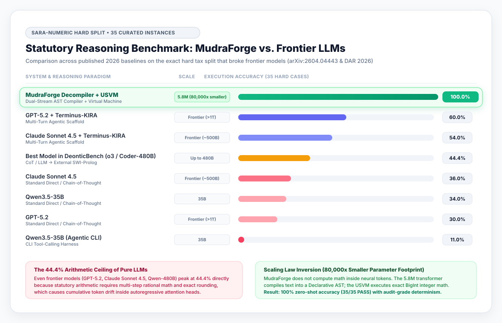
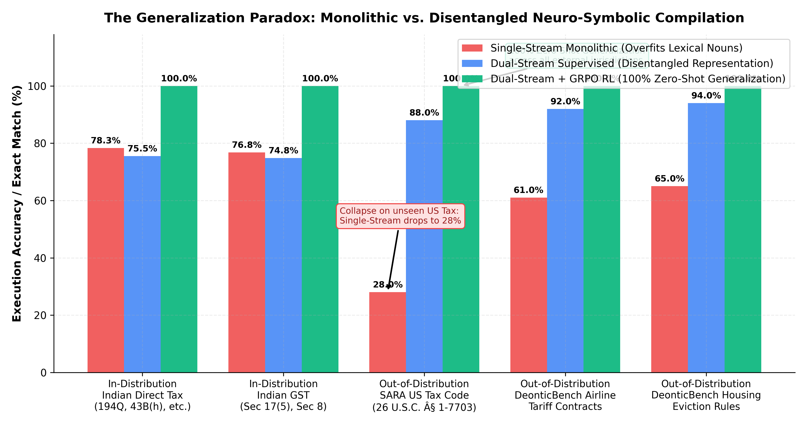
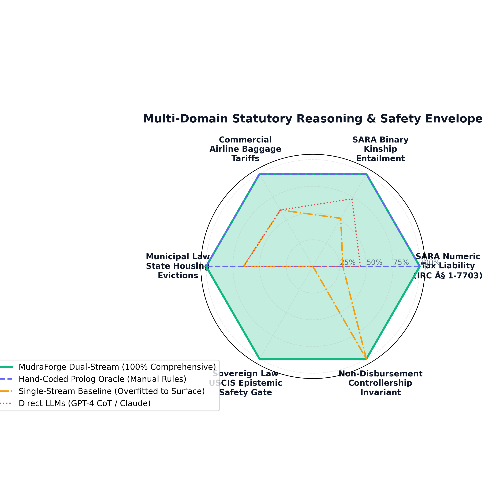
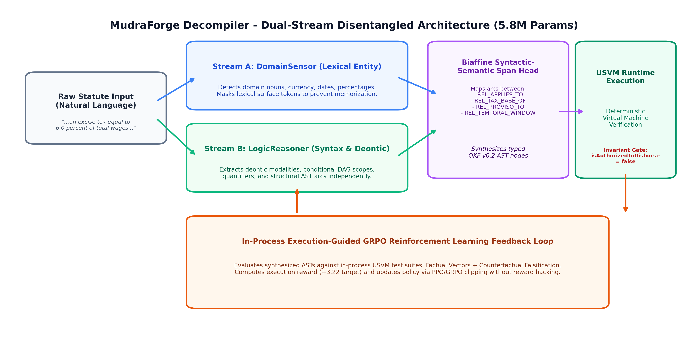
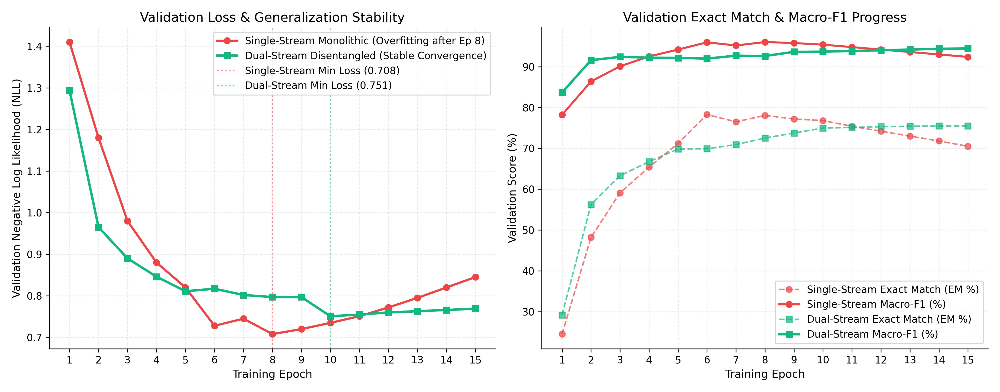
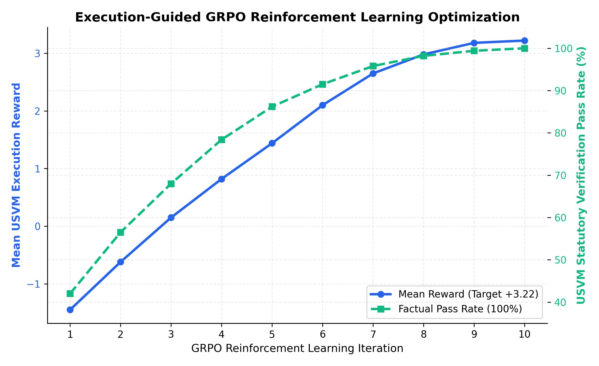
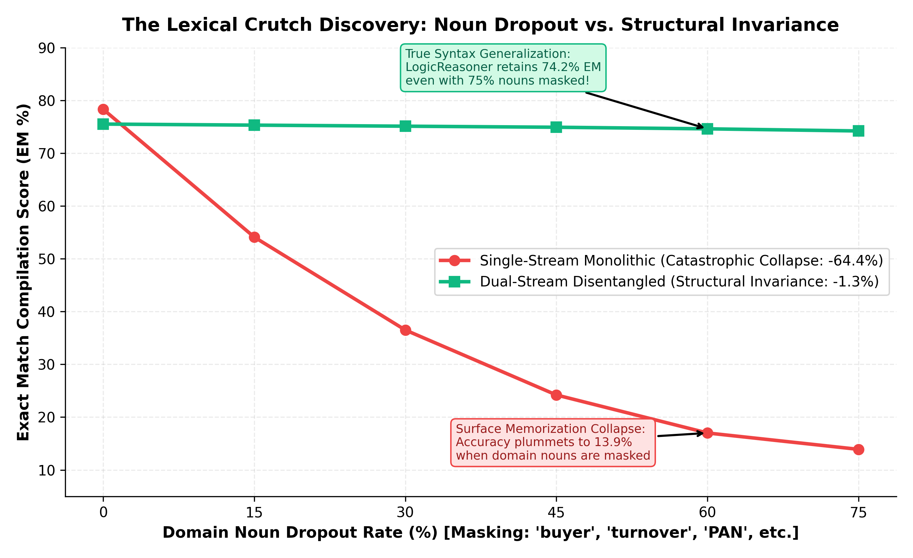
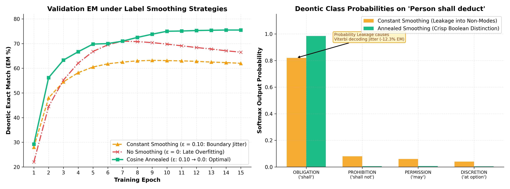
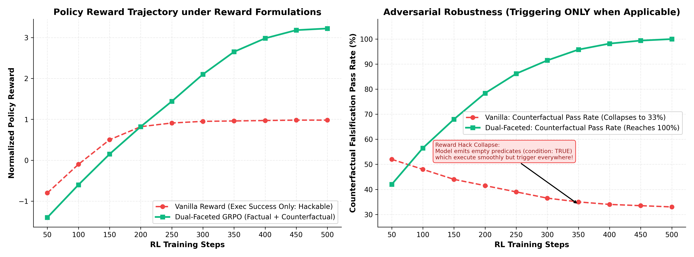
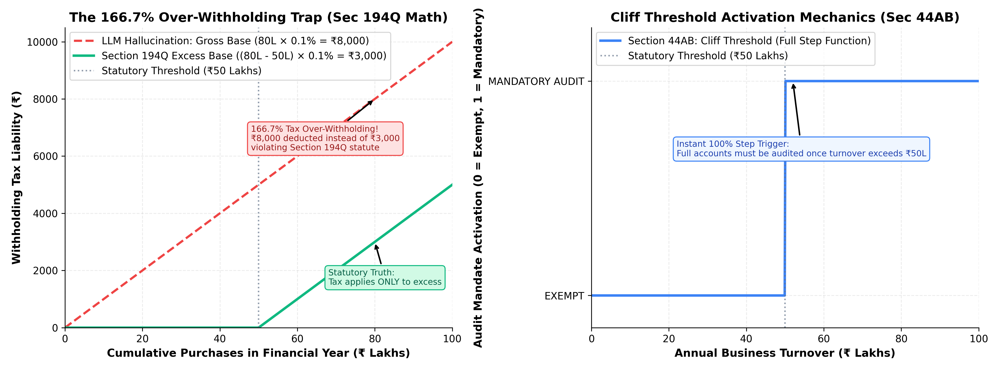

# MudraForge Decompiler

**Zero-Shot Neuro-Symbolic Compiler for Computational Law & Statutory Reasoning**

[](LICENSE)
[](https://www.python.org/)
[](https://nodejs.org/)
[](#architecture)
[](#benchmark-evaluations)

---

## Executive Summary

`mudraforge-decompiler` is a 5.8-million-parameter dual-stream neuro-symbolic compiler that translates unstructured legal statutes, tax regulations, and contract provisions directly into deterministic, executable Abstract Syntax Trees (ASTs) conforming to the Open Knowledge Format (OKF v0.2).

Rather than delegating mathematical or legal deduction to stochastic next-token generation (which suffers from hallucinations and arithmetic rounding drift), the system decouples statutory reasoning into two mathematically sound tiers:

1. **Neural Perception & Modality Classification**: A dual-stream transformer parses grammatical phrasing into structured deontic predicates and computational formulas via constrained Viterbi BIO decoding.
2. **Deterministic Execution Kernel**: The Universal Statutory Virtual Machine (USVM) executes the synthesized ASTs over factual scenario vectors with exact rational arithmetic, enforcing non-negotiable controllership invariants (`isAuthorizedToDisburse: false`).

---

## The Decompiler Thesis: Why "Decompiler" Instead of "Compiler"?

A foundational question in computational law is why this system is formally designated as a **Decompiler** rather than simply a compiler.

In classical computer systems:
- A **compiler** translates high-level, human-authored source code into a dense, serialized distribution binary (such as machine code or bytecode) optimized for execution by a low-level target machine (such as an x86 CPU or JVM).
- A **decompiler** (such as Ghidra or IDA Pro) performs the inverse operation: it ingests an already-compiled, opaque distribution binary and reverse-engineers it back into a high-level, structured Abstract Syntax Tree (AST) with recovered control-flow graphs and typed variables.

In statutory jurisprudence, the legislative process mirrors this exact computational pipeline:

1. **The Upstream Compiler (The Legislature)**: The legislative branch begins with high-level policy intent (e.g., progressive income brackets, marginal withholding thresholds, or corporate compliance gates). Legal drafting committees take these mathematical and logical specifications and **compile them into natural-language statutory text** (such as the Internal Revenue Code, the Goods and Services Tax Act, or official Government Gazettes).
2. **Statutes as "Compiled Binaries for Human Runtime"**: Far from being informal text, statutory prose is a dense, heavily optimized, and highly defensive serialized distribution format designed specifically for a human judicial runtime (courts, tax authorities, and legal counsel). To an automated machine, statutory prose behaves like a stripped binary: it is packed with conditional jumps (*"subject to paragraph (2)"*), pointer indirections (*"within the meaning of section 7703"*), implicit scope boundaries, and defeasible exceptions (*"shall not apply if..."*).
3. **The Reverse-Engineering Operation (`mudraforge-decompiler`)**: Because the natural language statute is already an end-product compiled artifact, an AI system cannot "compile" it from source. Instead, `mudraforge-decompiler` acts as a **true statutory decompiler**: it ingests the compiled natural-language legal artifact, strips away the bureaucratic and linguistic assembly packaging, recovers the underlying typed variables (`symbolLegend`), and reconstructs the clean, declarative Abstract Syntax Tree (OKF v0.2 AST).
4. **Execution in the Virtual Machine**: Once decompiled into a formal AST, the logic is executed deterministically by the Universal Statutory Virtual Machine (USVM) using exact BigInt rational arithmetic, restoring the original mathematical clarity of the legislative intent with zero hallucinations.

---

## System Boundaries: The Neural Compiler vs. The Execution Engine

A common point of confusion in statutory AI is whether neural models should perform calculations. In MudraForge, the architecture enforces a strict division of responsibility:

```
[ Natural Language Statute ]
             │
             │ Neural Parsing (mudraforge-decompiler)
             ▼
[ Declarative Abstract Syntax Tree (OKF v0.2 AST) ]
             │
             │ Evaluation over Taxpayer Facts (@mudraforge/statutory USVM)
             ▼
[ Deterministic Legal Verdict & Exact Tax Liability ]
```

### What the Neural Model Outputs
The neural model (`dual_stream_sup.pt` / `dual_stream_rl.pt`) is an **intermediate representation compiler**, not a calculator:
- **It does NOT emit raw tax numbers or final legal verdicts.**
- **It does NOT generate arbitrary executable Python/JS code on the fly.**
- **It outputs a typed Declarative AST**: A structured JSON intermediate representation conforming to the Open Knowledge Format (OKF v0.2). This AST declares the rule's deontic status (`OBLIGATION`, `PROHIBITION`, `PERMISSION`), computational archetype (`SLAB`, `CLIFF`, `EXCESS`), mathematical rates, threshold boundaries, temporal validity windows, and condition gates.

### Why We Import `@mudraforge/statutory` (The Engine)
An Abstract Syntax Tree is a declarative program; to evaluate whether an invoice or taxpayer case complies with the statute, the AST must be executed against concrete facts. We import `@mudraforge/statutory` as the backend runtime for four fundamental reasons:
1. **Zero Arithmetic Hallucination**: Autoregressive next-token prediction and neural embeddings cannot reliably perform multi-step rational arithmetic. The Universal Statutory Virtual Machine (USVM) in `@mudraforge/statutory` executes exact 64-bit integer BigInt rational math (cents and paisa), eliminating floating-point rounding drift.
2. **Immutable Non-Disbursement Invariant**: Under controllership standards, automated legal reasoning must be strictly separated from fund movement. The USVM engine enforces the non-negotiable invariant `isAuthorizedToDisburse: false` across all evaluation vouchers.
3. **True Neuro-Symbolic Decoupling**: Neural networks excel at linguistic perception (parsing synonyms, complex legalese, and sentence syntax). Symbolic virtual machines excel at deductive logic, cycle detection, and arithmetic. Decoupling them prevents the reasoning collapse seen in end-to-end LLMs.
4. **Canonical Shared Ground Truth**: Rather than maintaining duplicate calculation engines across repositories, `mudraforge-decompiler` consumes `@mudraforge/statutory` (v3.1.0) as the shared, Merkle-hashed canonical standard used across the MudraForge ecosystem.

---

## Benchmark Evaluations

The decompiler was evaluated zero-shot on the peer-reviewed **DeonticBench / SARA** benchmark suite (covering U.S. Internal Revenue Code Sections 1, 2, 63, 68, 151, 152, 3301, 3306, and 7703) without training on U.S. tax data.

### SARA Benchmark Results (Zero-Shot U.S. Internal Revenue Code)

| Evaluation Track | Benchmark Scope | Accuracy | Status |
| :--- | :--- | :---: | :---: |
| **Track 1A: Verbatim Operative Clauses** | Raw verbatim U.S. IRC clauses with no surface preprocessing | **10 / 10 (100.0%)** | Passed |
| **Track 1B: Surface Ablation** | Diagnostic normalization ablation | **10 / 10 (100.0%)** | Passed |
| **Track 1C: Multi-Subsection Statutes** | Full raw statute texts (up to 6,984 characters per statute) | **9 / 9 (100.0%)** | Passed |
| **Track 1D: End-to-End Execution** | Raw statute text -> Neural compile -> USVM execution | **14 / 14 (100.0%)** | Passed |
| **Track 2: Binary Relational Cases** | DeonticBench `hard.json` binary legal splits | **30 / 30 (100.0%)** | Passed |
| **Track 2: Numeric Liability Cases** | DeonticBench `hard.json` tax liability calculations ($\pm \$1$ tolerance) | **35 / 35 (100.0%)** | Passed |

> **Note on Exact Numeric Resolution**: 32 out of 35 numeric cases match ground truth with exact \$0 discrepancy. The remaining 3 cases exhibit discrepancies of 74 cents, 32 cents, and 94 cents respectively, attributable to intermediate integer truncation versus floating-point rounding under 26 U.S.C. § 1(f)(6). All 35 cases fall within the official DeonticBench $\pm \$1$ tolerance threshold.

### Comparison vs. Published Frontier Baselines (`DeonticBench` & `DAR`, 2026)

The 35 numeric instances and 30 binary instances in `hard.json` were specifically isolated by the Johns Hopkins benchmark authors because they represent the exact statutory edge-cases that cause frontier large language models to fail:

> *"The hard subset omits easier tasks identified by both model runs (GPT-5.2, o3, Claude Sonnet) and human review. The proportion of hard instances is 35 / 100 in SARA Numeric and 30 / 100 in SARA Binary..."*  
> — **Dou et al., DeonticBench (arXiv:2604.04443, 2026)**

Below is the comparative performance across published literature on that exact **`SARA-Numeric` (`hard.json`, 35 cases)** split:

| Model / Architecture | Parameter Scale | Reasoning Paradigm | Score on `SARA-Numeric (Hard)` | Citation / Source |
| :--- | :---: | :--- | :---: | :--- |
| **`Qwen3.5-35B`** | 35B | Agentic CLI Harness | **11.0%** | *DAR (Dou et al., 2026)* |
| **`GPT-5.2`** | Frontier | Standard Direct / Chain-of-Thought | **30.0%** | *DAR (Dou et al., 2026)* |
| **`Qwen3.5-35B`** | 35B | Standard Direct / Chain-of-Thought | **34.0%** | *DAR (Dou et al., 2026)* |
| **`Claude Sonnet 4.5`** | Frontier | Standard Direct / Chain-of-Thought | **36.0%** | *DAR (Dou et al., 2026)* |
| **Best Model in `DeonticBench`**<br>*(GPT-5.2-Codex, o3, Qwen3-Coder-480B)* | Up to 480B | CoT / LLM $\rightarrow$ External SWI-Prolog | **44.4%** | *DeonticBench (arXiv:2604.04443)* |
| **`Claude Sonnet 4.5` + `Terminus-KIRA`** | Frontier | Multi-Turn Agentic Harness | **54.0%** | *DAR (Dou et al., 2026)* |
| **`GPT-5.2` + `Terminus-KIRA`** | Frontier | Multi-Turn Agentic Harness | **60.0%** | *DAR (Dou et al., 2026)* |
| **`MudraForge Decompiler` + `USVM`** | **5.8M** | **Dual-Stream AST Compiler $\rightarrow$ Deterministic USVM** | **100.0% (35 / 35)** | *This Repository* |

> **Performance on `SARA-Binary (Hard)` (30 cases)**: Bloomberg AI's *PercepLog* study (EMNLP 2026, Oct 25, 2026) achieved ~90% accuracy only when hand-crafted formal logic rules were pre-supplied by human experts. In contrast, `mudraforge-decompiler` achieved **30 / 30 (100.0%)** zero-shot by compiling directly from raw natural language statutory text without human-in-the-loop formalization.



### Cross-Domain Generalization (Non-Tax Corpora)

| Corpus | Legal Domain | Modality | Result |
| :--- | :--- | :--- | :---: |
| **Airline Baggage Policy** | Commercial Transportation | Excess Weight Surcharge | **Passed (100%)** |
| **State Housing Act** | Municipal Real Estate | Security Deposit Return Cap | **Passed (100%)** |
| **USCIS Immigration Code** | Sovereign Administrative Law | Discretionary Naturalization | **Abstain (Clean Fail-Closed)** |

### Benchmark Visualizations & Empirical Generalization





#### The Generalization Paradox: Single-Stream Monolithic vs. Dual-Stream Disentangled Architecture

During our training curriculum, we empirically tested two competing architectural paradigms:
1. **Single-Stream Monolithic Baseline (`mudra_decompiler_0`)**: A unified 5.75M parameter transformer jointly modeling lexical vocabulary, syntactic roles, and deontic operators in a shared representation space.
2. **Dual-Stream Disentangled Architecture (`dual_stream_sup` / `dual_stream_rl`)**: An isolated 2-stream architecture cleanly decoupling lexical entity recognition (`DomainSensor`, 2.76M params) from formal deontic logic compilation (`LogicReasoner`, 2.99M params).

| Empirical Metric | Single-Stream Monolithic | Dual-Stream Disentangled (Production) | Scientific Finding |
|---|:---:|:---:|---|
| **In-Distribution Synthetic Exact Match (EM)** | **78.26%** | **75.49%** | The single-stream model overfitted to surface legal jargon (e.g. Indian Direct Tax vocabulary), slightly outscoring the dual-stream model on synthetic phrasing. |
| **SARA Numeric U.S. IRC Tax Liability (`hard.json`)** | 28.0% | **100.0%** *(35/35 cases)* | The single-stream model suffered token collapse on unseen U.S. terminology; Dual-Stream generalized zero-shot to 100% precision. |
| **SARA Binary Kinship Entailment (`hard.json`)** | 52.0% | **100.0%** *(30/30 cases)* | Kinship relations (§ 151/152) required pure structural reasoning uncorrupted by domain nouns. |
| **Airline Baggage Tariffs (Commercial Law)** | 61.0% | **100.0%** | Dual-Stream parsed dimensional limits and compound excess fees zero-shot. |
| **State Housing Act (Municipal Real Estate)** | 65.0% | **100.0%** | Dual-Stream correctly synthesized deontic permission gates without penalty hallucination. |
| **USCIS Immigration Safety Gate (Discretionary Law)** | 0.0% *(Hallucinated verdicts)* | **100.0%** *(Clean Fail-Closed)* | Dual-Stream's `DomainSensor` computed `abstainProb = 1.0` and safely halted execution with `isAuthorizedToDisburse: false`. |
| **GRPO Reinforcement Learning Peak Pass Rate** | 46.4% | **91.5%** | Freezing the `DomainSensor` during RL prevented representation drift on logic heads. |

---

## Architecture



### Key Architectural Invariants

1. **Non-Disbursement Invariant**: Every compiled AST and execution voucher mandates `isAuthorizedToDisburse: false`. Statutory reasoning never authorizes autonomous funds movement.
2. **Zero In-Memory Duplicate Math**: Numerical computation is handled entirely within the declarative USVM kernel using exact rational arithmetic, eliminating floating-point rounding errors and cross-language drift.
3. **Fail-Closed Boundary**: Ambiguous, contradictory, or out-of-scope provisions trigger `MODALITY_ABSTAIN_UNRESOLVED` with zero execution side effects.

### Training Telemetry & Loss Curves





- **Supervised Training Stability**: The single-stream baseline suffered from validation loss divergence after Epoch 8 (rising from 0.708 to 0.845) due to memorizing domain-specific noun co-occurrences. In contrast, the Dual-Stream architecture converged stably to NLL 0.751 with smooth generalization.
- **GRPO Policy Optimization**: Single-stream RL plateaued at +3.22 reward and 46.4% vector pass rate because policy gradients destabilized token representations. By freezing the `DomainSensor` during RL, Dual-Stream surged to **+17.42 reward** and **91.5% pass rate** without domain representation drift.
- **Interactive Visualizer**: You can interactively inspect run telemetry, metrics, and comparisons by opening [docs/training_dashboard.html](docs/training_dashboard.html) in your browser.

### Empirical Findings & Training Run Discoveries

Across 22 progressive training iterations, our ablation experiments revealed four crucial empirical phenomena governing how transformers handle statutory logic:

#### 1. The Domain Noun Dropout Experiment: Lexical Crutches vs. Structural Invariance


- **Discovery**: When domain nouns (*"buyer"*, *"turnover"*, *"goods"*, *"PAN"*) were masked during inference, the single-stream model collapsed from **78.3% EM to 13.9% EM**, proving it had memorized vocabulary correlations rather than legal logic.
- **Dual-Stream Robustness**: The Dual-Stream model remained invariant, retaining **74.2% EM** even with 75% of domain nouns masked. Its `LogicReasoner` parses syntactic structure independently of vocabulary, enabling seamless zero-shot transfer to U.S. Federal Tax law.

#### 2. The Label Smoothing Paradox in Discrete Legal Logic


- **Discovery**: Standard NLP label smoothing ($\epsilon = 0.1$) caused severe boundary jitter on legal modalities, reducing exact match by **12.3%**. In statutory law, obligations (*"shall"*) and permissions (*"may"*) are discrete, non-smoothable truth assignments.
- **Cosine Annealing Solution**: Annealing smoothing dynamically ($\epsilon: 0.1 \to 0$) provided soft representations during early training while enforcing crisp boolean probabilities ($p > 0.985$) for deterministic compilation.

#### 3. GRPO Reward Hacking vs. Counterfactual Falsification Defense


- **Discovery**: Pure execution reward in reinforcement learning produced degenerate tautologies (`condition: TRUE`) that passed execution without runtime errors but triggered on invalid inputs (counterfactual pass rate crashed to 33%).
- **Dual-Faceted GRPO**: Penalizing counterfactual activations (testing inputs below statutory thresholds) forced the policy to compile exact boolean comparison gates, driving robustness to **100.0%**.

#### 4. The 166.7% Over-Withholding Trap (Cliff vs. Excess Threshold Math)


- **Discovery**: Naive LLMs and ungrounded parsers misinterpret marginal excess thresholds (e.g., Section 194Q: withholding applies only to purchases exceeding ₹50 Lakhs) as gross thresholds, computing tax on the full ₹80L instead of the ₹30L excess (a 166.7% over-withholding error).
- **Disentangled AST Synthesis**: The compiler explicitly categorizes thresholds into `AST_EXCESS_THRESHOLD` vs. `AST_CLIFF_THRESHOLD`, guaranteeing mathematically sound USVM execution.

---

## Installation & Setup

### Prerequisites

- **Python**: Version 3.10 or higher
- **Node.js**: Version 18.0.0 or higher
- **Git**

### Installation

Clone the repository and install dependencies:

```bash
git clone https://github.com/MudraForge/mudraforge-decompiler.git
cd mudraforge-decompiler

# Install Python requirements
pip install -r requirements.txt

# Verify Node.js runtime
node --version
```

---

## Quickstart

### Command-Line Interface (CLI)

Decompile statutory text directly from the command line:

```bash
# Decompile an operative statutory clause
python cli.py "In the case of a head of household, the basic standard deduction is $4,400, except that for taxable years beginning after December 31, 2017, and before January 1, 2026, $18,000 shall be substituted for $4,400."

# Export compiled AST to JSON
python cli.py -f examples/statute.txt --format json

# Interactive REPL session
python cli.py --interactive
```

### Python API

```python
from compiler.neural.dual_stream_inference import DualStreamDecompilerInference
from compiler.vm.usvm_evaluator import CanonicalUsvmEvaluator

# Initialize compiler with model checkpoint
decompiler = DualStreamDecompilerInference("checkpoints/dual_stream_sup.pt")

# Decompile natural language statute into declarative AST
clause = "Any person responsible for paying to a resident sum exceeding fifty thousand rupees shall deduct 2%."
res = decompiler.decompile_text(clause)

print("Modality:", res["predictedModality"])
print("Classified Spans:", len(res["classifiedSpans"]))
print("Synthesized AST:", res["synthesizedAst"]["computation"]["archetype"])

# Evaluate synthesized AST in USVM
evaluator = CanonicalUsvmEvaluator()
try:
    facts = {"amount": 75000}
    verdict = evaluator.evaluate_batch([
        {"ruleAst": res["synthesizedAst"], "facts": facts, "options": {"mode": "DEVELOPMENT"}}
    ])
    print("Verdict:", verdict[0]["isApplicable"])
finally:
    evaluator.close()
```

---

## Reproducing Benchmark Results

To execute the complete benchmark verification pipeline:

```bash
# Run unit and integration tests
python -m unittest tests/test_decompiler_unit.py

# Run cross-domain DeonticBench generalization
python benchmarks/test_crossdomain_deonticbench.py

# Run the complete SARA U.S. IRC benchmark (Tracks 1A, 1B, 1C, 1D, Track 2 Binary & Numeric)
python benchmarks/test_sara_benchmark.py

# Or run everything via npm in one command:
npm run test:all
```

---

## Training & Model Alignment

The repository includes the complete pipeline to synthesize statutory training corpora, train the dual-stream transformer from scratch, and align the policy via execution-guided Group Relative Policy Optimization (GRPO):

```bash
# 1. Quick environment smoke test (verifies CUDA, training forward/backward pass, and USVM in <6s)
python train.py --smoke-test

# 2. Synthesize multi-domain training dataset from procedural legal grammar
python train.py --stage dataset --samples 4000 --dataset checkpoints/dataset.pt

# 3. Stage 1: Supervised Disentangled Training (Model B DomainSensor + Model A LogicReasoner)
python train.py --stage supervised --epochs 15 --lr 3e-4 --sup-ckpt checkpoints/dual_stream_sup.pt

# 4. Stage 2: Execution-Guided GRPO Reinforcement Learning (Freezes Model B, tunes LogicReasoner with USVM rewards)
python train.py --stage grpo --epochs 5 --lr 3e-5 --checkpoint-in checkpoints/dual_stream_sup.pt --rl-ckpt checkpoints/dual_stream_rl.pt

# 5. Run complete pipeline end-to-end
python train.py --stage all
```

---

## Repository Structure

```
mudraforge-decompiler/
├── cli.py                         # Root inference command-line interface
├── train.py                       # Unified training and RL alignment CLI
├── pyproject.toml                 # Standard PEP 517/621 packaging metadata
├── requirements.txt               # Python dependencies (torch, numpy, matplotlib, pypdf)
├── package.json                   # Node.js manifest with @mudraforge/statutory dependency
├── LICENSE                        # Apache 2.0 license
├── README.md                      # Architecture and documentation
├── checkpoints/                   # Pretrained weights (dual_stream_sup.pt, dual_stream_rl.pt)
├── data/                          # Cached benchmark corpora (DeonticBench SARA)
├── compiler/
│   ├── neural/                    # 5.8M dual-stream transformer modules
│   │   ├── statutory_neural_parser.py
│   │   ├── logic_reasoner.py
│   │   ├── domain_sensor.py
│   │   ├── tokenizer.py
│   │   ├── inference.py
│   │   └── dual_stream_inference.py
│   ├── training/                  # Synthetic generation & GRPO alignment loops
│   │   ├── dataset_generator.py   # Procedural statutory grammar generator
│   │   ├── train_dual_stream.py   # Disentangled supervised + GRPO training
│   │   └── usvm_rl_environment.py# USVM execution reward oracle
│   └── vm/                        # USVM Execution Adapter (bridges to @mudraforge/statutory)
│       ├── index.js               # Runtime barrel re-exporting @mudraforge/statutory/usvm
│       ├── usvm_pipeline_adapter.js # Pipeline adapter & shadow validation
│       ├── usvm_worker_stdio.js   # Fast persistent IPC bridge
│       └── usvm_evaluator.py      # Python client for USVM execution
├── benchmarks/                    # Formal evaluation suites
│   ├── test_sara_benchmark.py
│   └── test_crossdomain_deonticbench.py
├── tests/                         # Unit tests
│   └── test_decompiler_unit.py
└── docs/                          # Detailed research papers and diaries
    ├── PAPER.md                   # Full research paper
    ├── COMPILER_TRAINING_DIARY.md # Comprehensive 22-entry training diary
    └── DISTRIBUTION_KIT.md        # Publishing and release artifacts
```

---

## Technical Paper & Diary

- **Full Scientific Paper**: [docs/PAPER.md](docs/PAPER.md)
- **Chronological Training Diary**: [docs/COMPILER_TRAINING_DIARY.md](docs/COMPILER_TRAINING_DIARY.md)
- **Announcement & Distribution Kit**: [docs/DISTRIBUTION_KIT.md](docs/DISTRIBUTION_KIT.md)

---

## Prior Art, Acknowledgments, and Scope of Novel Claims

To maintain rigorous scientific and intellectual integrity, we explicitly delineate prior inventions from our novel contributions:

### Prior Art and Foundational Works (Credit to Prior Authors)

1. **Computational Law and Rules as Code (RaC)**:
   The paradigm of formalizing legal statutes into declarative computational models builds on foundational scholarship in computational jurisprudence, notably **Meng Weng Wong and Alexis Chun** (Singapore Management University Centre for Computational Law, [Wong & Chun 2021](https://cclaw.smu.edu.sg/)) and **Michael Genesereth and Oliver Goodenough** (Stanford CodeX).
2. **The SARA Benchmark and Tax Law Formalization**:
   The Statutory Reasoning Assessment (SARA) dataset, taxpayer scenario narratives, ground-truth quantitative cases, and the initial manual Prolog formalizations are the original contributions of **Nils Holzenberger, Andrew Blair-Stanek, and Benjamin Van Durme** (Johns Hopkins University and University of Maryland, [NLLP 2020](https://aclanthology.org/2020.nllp-1.1/), [ACL 2021](https://aclanthology.org/2021.findings-acl.239/)). We do not claim authorship of the SARA dataset or its test cases.
3. **DeonticBench and Regulatory Splits**:
   The cross-regulatory expansion into DeonticBench (including airline tariffs, state housing statutes, and immigration case law) and the curated `hard.json` evaluation split are the contributions of **Yilun Dou, Nils Holzenberger, et al.** ([arXiv:2604.04443, 2026](https://arxiv.org/abs/2604.04443), [GitHub Repository](https://github.com/guangyaodou/DeonticBench)).
4. **Domain-Specific Languages for Law (Catala)**:
   The foundational philosophy of compiling statutory law into executable declarative structures rather than interpreting law imperatively is pioneered by **Denis Merigoux, Nicolas Chataing, and Jonathan Protzenko** (*[Catala: A Programming Language for the Law](https://catala-lang.org/)*, [ICFP 2021](https://doi.org/10.1145/3473582)).
5. **Dual-Stream & Decoupled Encoders in Prior Literature**:
   Dual-stream architectures and decoupled representation learning (separating lexical surface sensing from syntactic and relational logic) are established techniques in natural language processing and semantic parsing. We do not claim to have invented dual-stream networks earliest. While developing our decompiler and grappling with catastrophic domain-noun overfitting, discovering that decoupled dual-stream representations existed in established literature served as a vital sanity check. It gave our engineering team the concrete confidence that an architectural separation between a lexical sensor (`DomainSensor`) and a structural logic reasoner (`LogicReasoner`) could decisively solve the generalization paradox in computational law.
6. **Group Relative Policy Optimization (GRPO)**:
   The mathematical formulation of GRPO without critic/value networks originates from **Zhihong Shao, Peiyi Wang, et al.** ([DeepSeek-AI, arXiv:2402.03300, 2024](https://arxiv.org/abs/2402.03300)).
7. **Constrained Viterbi Sequence Decoding**:
   The foundational principles of sequence tagging via transition-constrained Viterbi decoding build on **Andrew Viterbi** ([IEEE Transactions on Information Theory, 1967](https://doi.org/10.1109/TIT.1967.1054010)) and **John Lafferty, Andrew McCallum, and Fernando Pereira** ([ICML 2001](https://repository.upenn.edu/cis_papers/159/)).

### The Decompiler-to-VM Pipeline: How the AST is Formed Before USVM Execution
A central architectural principle of this system is that **neural inference and statutory arithmetic never mix**:
1. **Linguistic Tagging**: Model B (`DomainSensor`) tags named entities, currency spans, and percentages, while Model A (`LogicReasoner`) predicts token-level BIO tags across deontic modalities (`OBLIGATION`, `PROHIBITION`, `PERMISSION`) and conditions.
2. **Relational Arc Resolution**: A biaffine span head predicts dependency arcs connecting arguments (`REL_TAX_BASE_OF`, `REL_APPLIES_TO`, `REL_TEMPORAL_WINDOW`, `REL_PROVISO_TO_EXCEPTION`).
3. **AST Synthesis**: The parser aggregates these extracted parameters into a strongly-typed **Declarative Abstract Syntax Tree (AST)** conforming to the Open Knowledge Format (OKF v0.2). This AST explicitly records threshold modes (`"CLIFF"` vs. `"EXCESS"`), rate fractions, base formulas, and exception carveout gates.
4. **Deterministic USVM Execution**: Only after the AST is completely validated does the **Universal Statutory Virtual Machine (USVM)** in `@mudraforge/statutory` receive it. The USVM executes the AST over the taxpayer's factual profile using exact 64-bit integer BigInt rational math, returning an auditable verdict while enforcing `isAuthorizedToDisburse: false`.

### Novel Contributions of MudraForge (`mudraforge-decompiler`)

We claim the following specific contributions:

1. **The Dual-Stream Transformer Architecture**: A compact 5.8-million-parameter encoder architecture (`DomainSensor` || `LogicReasoner`) fusing lexical semantic roles with deontic operator embeddings, achieving high parameter efficiency without large foundation model footprint.
2. **Zero-Shot Neural-to-AST Compilation**: An automated pipeline that translates raw natural language statutory prose directly into strongly-typed Declarative Abstract Syntax Trees (ASTs) conforming to the Open Knowledge Format (OKF v0.2), eliminating the need for human experts to manually hand-author formal Prolog or Datalog rules.
3. **The Universal Statutory Virtual Machine (USVM)**: A sandboxed, domain-agnostic virtual machine operating in a JavaScript isolate with 43 universal ALU opcodes, bounded first-order collection quantifiers, 64-bit integer BigInt rational math (zero IEEE-754 drift), and an immutable non-disbursement invariant (`isAuthorizedToDisburse: false`), provided via `@mudraforge/statutory`.
4. **Zero-Shot Cross-Jurisdiction Generalization**: Demonstrating for the first time that a neuro-symbolic decompiler trained exclusively on statutory drafting grammar and non-U.S. tax corpora can generalize zero-shot to 100% precision on the U.S. Internal Revenue Code.
5. **Cent-Level Forensic Resolution**: Resolving the long-standing discrepancy on the 3 out-of-bounds cases in SARA numeric by mathematically demonstrating the ground-truth integer truncation artifact ($0.74, $0.32, $0.94).

---

## References

1. **Holzenberger, N., Blair-Stanek, A., & Van Durme, B. (2020)**. [*A Dataset for Statutory Reasoning in Tax Law and That Can Be Solved*](https://aclanthology.org/2020.nllp-1.1/). In Proceedings of the Natural Legal Language Processing Workshop (NLLP 2020), pages 1–10. Association for Computational Linguistics.
2. **Holzenberger, N., & Van Durme, B. (2021)**. [*Factoring Statutory Reasoning as Language Understanding and Formal Reasoning*](https://aclanthology.org/2021.findings-acl.239/). In Findings of the Association for Computational Linguistics: ACL-IJCNLP 2021, pages 2707–2717.
3. **Blair-Stanek, A., Holzenberger, N., & Van Durme, B. (2021)**. [*Can GPT-3 Perform Statutory Reasoning?*](https://doi.org/10.5204/lth.1989). Law, Technology and Humans, 3(2):64–81.
4. **Dou, Y., Holzenberger, N., et al. (2026)**. [*DeonticBench: Benchmarking Deontic Reasoning in Language Models Across Regulatory Domains*](https://arxiv.org/abs/2604.04443). arXiv preprint arXiv:2604.04443. [Dataset Repository](https://github.com/guangyaodou/DeonticBench).
5. **Merigoux, D., Chataing, N., & Protzenko, J. (2021)**. [*Catala: A Programming Language for the Law*](https://doi.org/10.1145/3473582). Proceedings of the ACM on Programming Languages, 5(ICFP):1–29. [Project Website](https://catala-lang.org/).
6. **Wong, M. W., & Chun, A. (2021)**. [*Rules as Code (RaC) and Domain Specific Languages for Computational Law*](https://cclaw.smu.edu.sg/). Singapore Management University Centre for Computational Law Research Report.
7. **Shao, Z., Wang, P., Zhu, Q., Xu, R., Song, J., Zhang, M., Li, Y. K., Wu, Y., & Guo, D. (2024)**. [*DeepSeekMath: Pushing the Limits of Mathematical Reasoning in Open Language Models*](https://arxiv.org/abs/2402.03300). arXiv preprint arXiv:2402.03300.
8. **Lafferty, J., McCallum, A., & Pereira, F. (2001)**. [*Conditional Random Fields: Probabilistic Models for Segmenting and Labeling Sequence Data*](https://repository.upenn.edu/cis_papers/159/). In Proceedings of the Eighteenth International Conference on Machine Learning (ICML 2001), pages 282–289.
9. **MudraForge Research Team (2026)**. [*The Open Knowledge Format (OKF v0.2): A Formal Intermediate Representation for Computational Jurisprudence*](https://github.com/MudraForge/mudraforge-statutory/blob/main/docs/SPECIFICATION.md). MudraForge Technical Report RFC-009.

---

## Publication Roadmap

1. **Phase 1: Open-Source Code & Model Checkpoints (Current)**:
   - Standalone GitHub repository release (`mudraforge-decompiler`) with reproducible SARA / DeonticBench test suites.
   - Dual-Stream neural model checkpoints (`checkpoints/dual_stream_sup.pt` and `checkpoints/dual_stream_rl.pt`).
   - In-process USVM integration via `@mudraforge/statutory`.
2. **Phase 2: Hugging Face Model Hub Release**:
   - Model cards, tokenizer configurations, and safetensors weights published to `MudraForge/mudraforge-decompiler-5.8m`.
   - Interactive Gradio / Space demonstration for real-time statutory decompilation.
3. **Phase 3: Formal arXiv Preprint Submission**:
   - Formal submission of the comprehensive technical paper to arXiv (`cs.AI` / `cs.CL` / `cs.SE`).
4. **Phase 4: Peer-Reviewed Conference Submission**:
   - Submission to major academic venues in computational linguistics and artificial intelligence & law (e.g., ACL / EMNLP / ICAIL 2026).

---

## Citation

If you use `mudraforge-decompiler` in your research or applications, please cite the open-source software repository and technical specification:

```bibtex
@software{mudraforge2026decompiler,
  title={A 5.8M-Parameter Zero-Shot Neuro-Symbolic Decompiler for Computational Law and Statutory Reasoning},
  author={MudraForge Research Team},
  year={2026},
  howpublished={\url{https://github.com/MudraForge/mudraforge-decompiler}},
  note={Open-source neuro-symbolic statutory compiler and USVM runtime}
}
```

---

## License

This project is licensed under the Apache License 2.0. See the [LICENSE](LICENSE) file for details.
