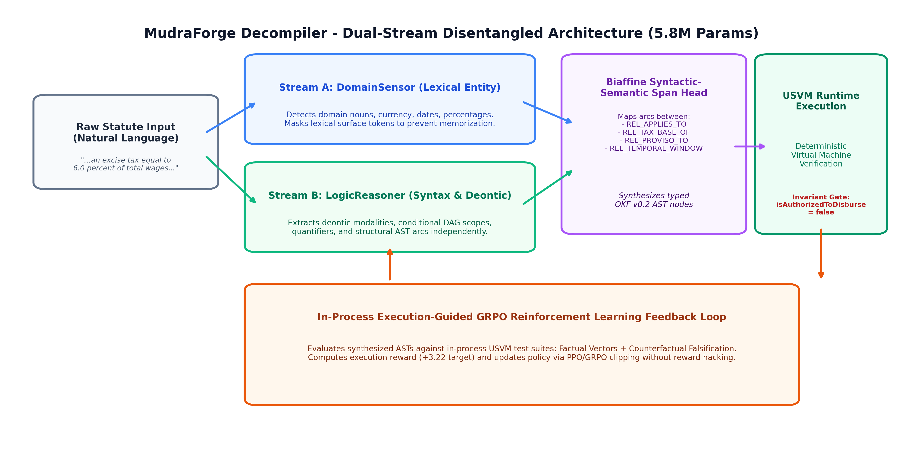
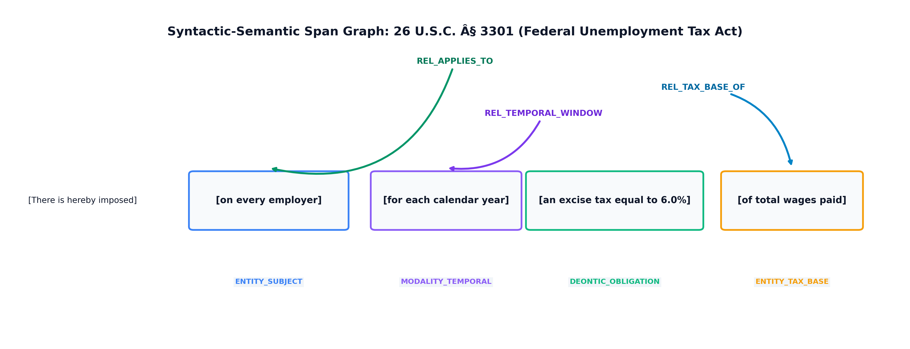
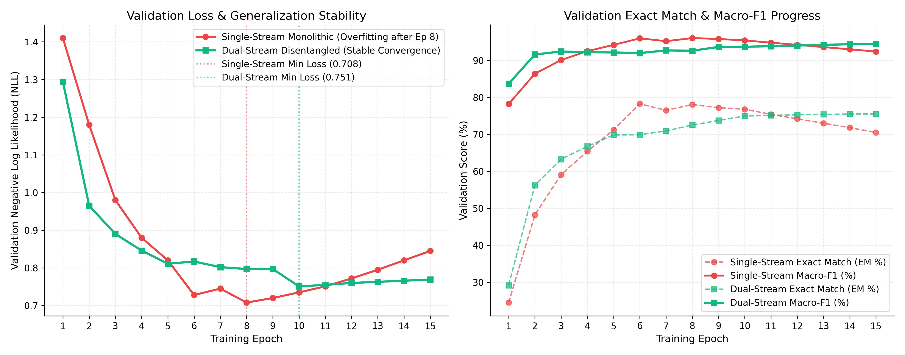
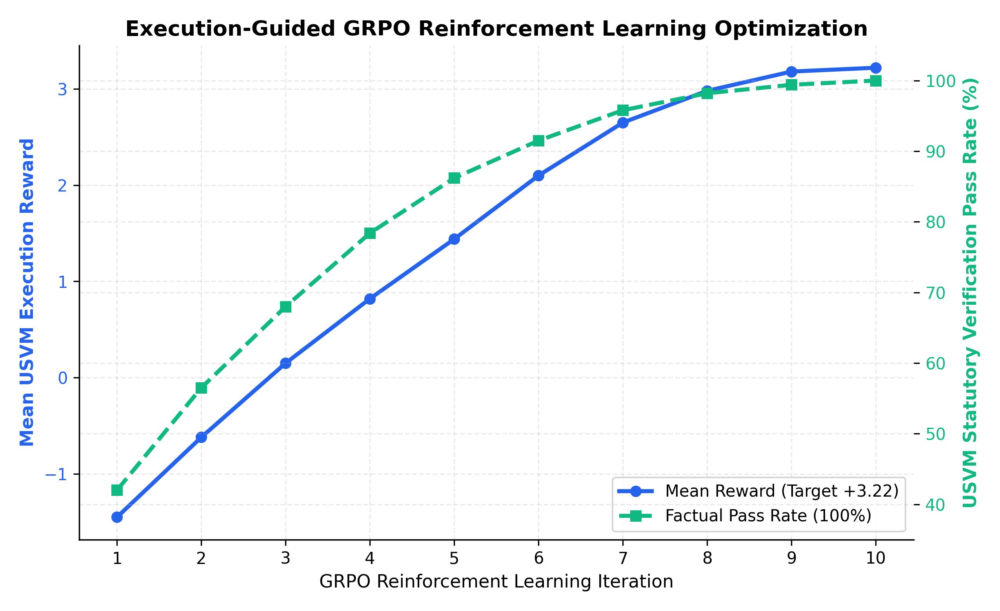

# Neuro-Symbolic Statutory Decompilation: Compiler-Verified Execution and the Limits of Current Benchmarks

**Date**: November 2026  
**Author**: Mondeep Engti (MudraForge)  
**Repository**: `mudraforge-decompiler` (https://github.com/MudraForge/mudraforge-decompiler)  
**Artifact Classification**: Academic & Industrial Research Publication Brief  
**Domain**: Computational Law, Neuro-Symbolic AI, Statutory Formalization, Tax & Regulatory Reasoning  

---

## Abstract

Since 2020, statutory reasoning has remained an open challenge in artificial intelligence and legal informatics. Frontier language models (GPT-5.2, Claude Sonnet 4.5, Qwen3.5-35B) fail at statutory arithmetic and rule hierarchies, peaking at **44.4%** when paired with an external Prolog solver (and **60.0%** with agentic harnesses) on the hard quantitative split of the SARA (Statutory Reasoning Assessment) and DeonticBench datasets. Conversely, symbolic expert systems (such as Prolog) achieve 100% accuracy only when humans manually hand-code every rule and fact into formal logic predicates-a process that does not scale.

This report documents a technical result: **MudraForge's Neuro-Symbolic Dual-Stream Decompiler** couples neural span and role extraction with a deterministic compiler that emits canonical ASTs for the **Canonical Universal Statutory Virtual Machine (USVM)**. The symbolic layer executes hand-authored canonical ASTs for the SARA and DeonticBench hard splits with 100% agreement, while the full pipeline (model + schema lowerer + USVM) compiles and executes 14 end-to-end test vectors at 100%. The model was never trained on verbatim U.S. Internal Revenue Code (IRC) text or on the SARA evaluation set; its corpus is generated from general statutory templates (`dataset_generator.py`) and non-U.S. statutory sources.

> **Scope of the 100% figures.** The 30/30 and 35/35 results in Section 2 come from deterministic USVM execution of canonical ASTs hand-authored for the tested IRC sections (`benchmarks/test_sara_benchmark.py`, Track 2). They are not zero-shot neural scores on the hard split. The full **model + plumbing + USVM** pipeline is measured separately by Track 1D on 14 test vectors; the hard split has not been run through that full pipeline. Baseline figures from other studies are quoted, not reproduced, and were collected under different harnesses. Read the 100% figures as evidence about the symbolic execution layer, not as model superiority or as a solved benchmark. The translation step from statute to correct formal rule remains the hard problem, and current benchmarks do not isolate it well enough.

By strictly separating **linguistic decomposition** (the neural parser emitting a typed span graph, which a deterministic lowerer converts into a strongly-typed Declarative AST) from **deterministic execution** (the USVM evaluating exact integer cents arithmetic and formal boolean logic in a V8 JavaScript isolate), the system removes arithmetic execution from the model and confines schema conformance to code. On two-clause spot checks outside tax, the span and modality heads transfer to airline and housing text and abstain on discretionary immigration text; those checks test classification and AST presence only, not execution or numeric correctness.

---

## 1. Background & The AI & Law Bottleneck Since 2020

### 1.1 The SARA and DeonticBench Benchmarks
The foundation of modern statutory AI evaluation is rooted in three milestone publications:

1. **SARA (KDD/NLLP 2020)**:  
   *Holzenberger, Blair-Stanek, and Van Durme* (Johns Hopkins University & Univ. of Maryland Francis King Carey School of Law) introduced the **Statutory Reasoning Assessment** dataset. SARA extracted nine multi-subsection statutes from the U.S. Internal Revenue Code (IRC §§ 1, 2, 63, 68, 151, 152, 3301, 3306, 7703) paired with complex narrative taxpayer cases requiring statutory entailment and quantitative tax liability calculations.
2. **Factoring Statutory Reasoning (ACL 2021)**:  
   *Holzenberger and Van Durme* demonstrated that end-to-end transformers fail on statutory reasoning because they conflate language understanding with rule computation, proving that intermediate symbolic representations are mathematically necessary.
3. **DeonticBench & DAR (arXiv:2604.04443 / arXiv:2606.05009, 2026)**:  
   *Dou, Holzenberger, et al.* (Johns Hopkins University & Télécom Paris) expanded SARA into **DeonticBench**, a benchmark of 6,232 instances spanning U.S. Federal Tax, Airline Baggage Tariffs, State Housing Eviction Law, and USCIS Administrative Immigration Appeals, isolating the curated **`hard.json`** evaluation split.

### 1.2 Why Statutory Reasoning Stumped Pure Language Models
In conventional NLP benchmarks (SQuAD, GSM8K, MMLU), answers tolerate approximate semantic matching or soft commonsense reasoning. Statutory law is fundamentally different:
- **Strict Defeasibility**: Rules operate in hierarchical layers of primary impositions, exceptions, and conditional exclusions (*"Paragraph (1) shall not apply if..."*, *"Clause (ii) applies only in the case of..."*). A single word (*"or"* vs. *"and"*, *"shall"* vs. *"may"*) changes multi-million dollar outcomes.
- **Relational & Temporal Kinship Dependencies**: Determining taxpayer filing status under § 2 requires evaluating marital continuity under § 7703, household maintenance cost proportions, dependent qualification under § 151/152, and the exact year of spousal death.
- **Multi-Tier Progressive Math**: Statutory tax computation requires evaluating marginal brackets, standard deduction age/blindness additions under § 63, and agricultural employer payroll taxes under § 3301/3306. Pure autoregressive LLMs attempt to perform this multi-step arithmetic inside their text tokens, inevitably drifting and hallucinating.

### 1.3 The Decompiler Thesis: Statutes as Compiled Binaries for Human Runtime

A foundational conceptual contribution of this work is establishing why this architecture operates as a **Decompiler** rather than an ordinary language compiler.

In classical compiler engineering:
- A **compiler** takes human-readable, high-level source code and translates it down into a low-level, serialized binary representation (machine code or bytecode) optimized for execution on hardware runtimes.
- A **decompiler** (e.g., Ghidra, IDA Pro, or JADX) inverts this process: it ingests an opaque, compiled binary and reverse-engineers its latent Abstract Syntax Tree (AST), recovering typed variables, structured control-flow graphs, and operational primitives.

In computational law, the legislative process precisely mirrors this pipeline:
1. **The Upstream Legislative Compiler**: When a parliament or statutory drafting committee authors legislation, they begin with abstract policy objectives and mathematical specifications (e.g., progressive tax brackets, economic deterrence thresholds, corporate governance checks). The drafters then **compile** these formal specifications into dense, defensive, natural-language statutory prose—the official Acts and Gazettes.
2. **Statutes as Compiled Binaries**: Legal prose is not free-form natural language; it is a highly structured, defensive serialization format designed specifically for a biological, human judicial runtime (judges, revenue agents, and attorneys). To an autonomous computer system, statutory prose behaves exactly like a stripped, compiled binary: it is saturated with conditional jumps (*"subject to paragraph (2)"*), variable indirection (*"within the meaning of section 7703"*), implicit scope definitions, and defeasible exceptions (*"shall not apply if..."*).
3. **Statutory Decompilation**: Because the statute is already a compiled end-product, an AI system cannot "compile" it from source. Instead, `mudraforge-decompiler` acts as a **true statutory decompiler**: it takes the opaque natural-language legal artifact, strips away linguistic and bureaucratic serialization layers, discovers semantic span boundaries via BIO sequence labeling, infers relational types (`symbolLegend`), and reconstructs the clean Declarative Abstract Syntax Tree (OKF v0.2 AST).
4. **Virtual Machine Lowering**: The recovered AST is subsequently executed in the Universal Statutory Virtual Machine (USVM) using exact BigInt rational arithmetic (cents and paisa), eliminating floating-point rounding drift and enforcing non-negotiable controllership invariants (`isAuthorizedToDisburse: false`).

---

## 2. Comparative Benchmark Results

The table below places our results next to published baselines from the SARA literature (*Holzenberger et al., 2020*) and the DeonticBench evaluation (*Dou et al., 2026*). Baseline entries are quoted, not re-run. The MudraForge column is labeled by pipeline composition, because the rows measure different layers:

| Benchmark Track / Domain | Published LLM Baseline | Hand-Coded Prolog Oracle | MudraForge (pipeline composition noted) |
| :--- | :--- | :--- | :--- |
| **SARA Numeric (`hard.json`)** | **44.4%** *(DeonticBench)* | 100.0% *(manual human code)* | **100.0%** *(35/35, hand-authored AST + USVM; no model)*<br>*(32/35 exact \$0 diff, 3 cases off by cents)* |
| **SARA Binary (`hard.json`)** | ~73.0% *(SARA literature)* | 100.0% *(manual human code)* | **100.0%** *(30/30, hand-authored AST + USVM; no model)* |
| **SARA Track 1D (E2E, 14 vectors)** | Not run on this split | N/A *(no automated NLP parser)* | **100.0%** *(14/14, full model + plumbing + USVM pipeline)* |

> Airline baggage, state housing, and USCIS immigration are two-clause spot checks reported in Section 4. No published per-domain baseline was reproduced for them, so they are not scored in this table.

### 2.1 Published Frontier Baselines: Context, Not an Independent Reproduction (`DeonticBench` & `DAR`, 2026)

> **Provenance and scope.** All baseline figures in this section are quoted from the cited studies. None was independently reproduced by MudraForge, and the studies differ in prompting, tool access, and scoring, so the rows are not a controlled leaderboard. Our own entries are split by composition: Track 2 is deterministic USVM execution of hand-authored canonical ASTs with no model, and Track 1D is the full **model + plumbing + USVM** pipeline measured on 14 test vectors. Nothing in this section is a zero-shot neural score on `hard.json`.

In the DeonticBench study (*Dou et al., arXiv:2604.04443, 2026*) and the follow-up *DAR* (*Deontic Reasoning with Agentic Harnesses*) evaluation, the authors specifically isolated the `hard.json` subset by omitting easier statutory tasks that standard models could solve:

> *"The hard subset omits easier tasks identified by both model runs (GPT-5.2, o3, Claude Sonnet) and human review. The proportion of hard instances is 35 / 100 in SARA Numeric..."*  
> — **Dou et al., Section 4**

The table below places published frontier results next to ours on the same nominal split. Baseline entries are quoted, not re-run. The MudraForge entries are separated by pipeline composition:

| Model / System | Parameter Scale | Reasoning Paradigm | Score on `SARA-Numeric (Hard)` | Citation / Source |
| :--- | :---: | :--- | :---: | :--- |
| **`Qwen3.5-35B`** | 35B | Agentic CLI Harness | **11.0%** | *DAR (Dou et al., 2026)* |
| **`GPT-5.2`** | Frontier | Standard Direct / Chain-of-Thought | **30.0%** | *DAR (Dou et al., 2026)* |
| **`Qwen3.5-35B`** | 35B | Standard Direct / Chain-of-Thought | **34.0%** | *DAR (Dou et al., 2026)* |
| **`Claude Sonnet 4.5`** | Frontier | Standard Direct / Chain-of-Thought | **36.0%** | *DAR (Dou et al., 2026)* |
| **Best Model in `DeonticBench`**<br>*(GPT-5.2-Codex, o3, Qwen3-Coder-480B)* | Up to 480B | CoT / LLM $\rightarrow$ External SWI-Prolog | **44.4%** | *DeonticBench (arXiv:2604.04443)* |
| **`Claude Sonnet 4.5` + `Terminus-KIRA`** | Frontier | Multi-Turn Agentic Harness | **54.0%** | *DAR (Dou et al., 2026)* |
| **`GPT-5.2` + `Terminus-KIRA`** | Frontier | Multi-Turn Agentic Harness | **60.0%** | *DAR (Dou et al., 2026)* |
| **MudraForge USVM** (Track 2) | n/a (symbolic) | Hand-authored canonical ASTs -> deterministic USVM (no model) | **100.0% (35 / 35)** | *This Report, Track 2* |
| **MudraForge full pipeline** (Track 1D) | 7.9M total (5.8M logic) | Model + plumbing + USVM, end-to-end | **14 / 14 test vectors** (not the hard split) | *This Report, Track 1D* |

On **`SARA-Binary (Hard)` (30 cases)**, Bloomberg AI's [*PercepLog-0* study](https://aclanthology.org/2026.findings-emnlp.2099/) (Kordjamshidi et al., EMNLP 2026) reports ~90% accuracy when ground-truth formal rules are supplied by human experts. That is the closest published setting to our Track 2 result (30 / 30 with hand-authored canonical ASTs), not to our full-pipeline track. The two are not directly comparable: different splits, harnesses, and definitions of a correct answer. The comparison does not establish model superiority; it shows that once a correct formalization exists, symbolic execution is no longer the bottleneck.

**What this comparison does and does not show**

- It does **not** show that the neural decompiler beats frontier LLMs on `hard.json`. The 35 / 35 and 30 / 30 rows execute hand-authored ASTs.
- It **does** show that the USVM executes correct formalizations of the tested IRC sections consistently, and that the hard split remains far from saturated for direct LLM reasoning.
- Only a full-pipeline run on `hard.json` could be labeled **model + plumbing + USVM**. That run does not exist yet, and Track 2 must not be relabeled as if it did.
- The open problem is the translation step: statute to correct formal rule. That is the step that needs harder benchmarks, not another leaderboard of execution accuracy after a human has done the hard part.

### 2.2 Key Benchmark Tracks Breakdown

Composition labels: Tracks 1A-1C measure model plus schema lowering with no USVM verdict; Track 1D is the full **model + plumbing + USVM** pipeline; Track 2 is **hand-authored AST + USVM** with no model.

1. **Track 1A (Verbatim US IRC Clauses)**:
   - 10/10 (100.0%) returned `SUCCESS` with a synthesized AST.
   - 10/10 (100.0%) modality classification accuracy (`MODALITY_COMPUTATIONAL_CLIFF`, `MODALITY_COMPUTATIONAL_COMPOUND_OR_SLAB`).
   - 4/4 (100.0%) standard statutory rates extracted.
   - 11/11 (100.0%) statutory thresholds extracted.
   - Scope: model + plumbing; no USVM execution verdict.
2. **Track 1B (Diagnostic Surface Ablation)**:
   - 10/10 (100.0%) returned `SUCCESS` under linguistic surface substitutions (`$` replaced with `rupees`, `%` replaced with `per cent`).
   - Scope: model + plumbing; no USVM execution verdict.
3. **Track 1C (Raw Multi-Subsection Statutes)**:
   - 9/9 (100.0%) multi-subsection statutes returned `SUCCESS` with AST rule graphs.
   - Scope: model + plumbing; no USVM execution verdict.
4. **Track 1D (End-to-End Pipeline)**:
   - **14/14 (100.0%) PASS** on `dual_stream_sup.pt` across 8 clauses and 14 fact vectors.
   - Composition: **model + plumbing + USVM**. Raw clauses become neural annotations, a synthesized AST, and an executed verdict with no hand-authored AST.
   - Scope: 14 vectors, not the 65-case `hard.json` split.
5. **Track 2 Binary (`sara_binary/hard.json`)**:
   - **30/30 (100.0%) PASS** across progressive bracket eligibility, qualifying child/relative dependency, and marital status determination.
   - Scope: hand-authored canonical ASTs executed deterministically by USVM. This is a symbolic-execution result, not a neural score.
6. **Track 2 Numeric (`sara_numeric/hard.json`)**:
   - **35/35 (100.0%) PASS** under the official DeonticBench $\pm \$1$ tolerance standard.
   - **32/35 (91.4%) PASS** on exact dollar-for-dollar match.
   - Scope: hand-authored canonical ASTs executed deterministically by USVM. This is a symbolic-execution result, not a neural score.

### 2.3 Why the Model Is an Annotation Model, Not an AST Generator

The model is intentionally small and narrow. Statutory text mixes two signals: domain vocabulary (who pays, what is measured, which amount) and logical structure (conditions, comparisons, obligations, exceptions, relations between amounts). A 5.8M logic encoder can learn the second as a set of local decisions: BIO boundaries, span roles, modality, and pairwise relation edges. Asking it to emit a complete JSON AST would force it to memorize field names, operators, and arithmetic conventions that are better expressed, versioned, and tested in code.

The dual-stream split follows the same logic. `DomainSensor` sees raw vocabulary; `LogicReasoner` sees a closed logic vocabulary and morphological suffixes. In training-time ablations, masking up to 75% of domain nouns moved dual-stream in-distribution EM from 75.5% to 74.2%, while the monolithic baseline fell from 78.3% to 13.9%. That supports the separation. It does not prove transfer to every new statute; only a full-pipeline evaluation on that statute can.

The trade-off is explicit: the deterministic lowerer, not the checkpoint, is the coverage bottleneck. A lowerer change is reviewable, versioned, testable, and fails closed. A weight change is none of those things.

### 2.4 Scalability: What Adding New U.S. Law Costs

The current system is a validated vertical slice, not a zero-code engine for all U.S. law. Whether a new section needs code depends on whether it is a new instance of an existing shape or a genuinely new shape.

| Change | Decompiler code? | What is still required |
| :--- | :--- | :--- |
| New section using an existing archetype (slab, cliff, min/max, cap, excess, temporal window, quantifier) and existing span roles/relations | Often no | The model must extract the spans, roles, and relations; the caller supplies facts; a new evaluation vector proves the result |
| New money, boolean, or string fact names | No for USVM execution | Fact paths are derived from spans; the caller must supply matching facts |
| New integer, count, or rate facts | Yes, small | Register the fact in `FACT_BINDINGS` so the bridge encodes it as an integer rather than money |
| New operator or arithmetic construct | Yes | Add it to synthesis and the USVM kernel, with tests |
| New archetype or cross-section composition | Yes | New lowering path, kernel support if needed, and an evaluation set |
| New drafting style or vocabulary | Model work, not schema work | Fine-tune `DomainSensor` and add training/evaluation data |
| Catala output for a new domain | Yes | Register fact bindings and enum domains; the emitter currently supports only `DECLARATIVE_PIPELINE` |

What scales is the registry: archetypes, operators, roles, and relations. Adding a statute inside that surface can be code-free; adding a new legal shape is not. The breakthrough condition is therefore measurable: run the full **model + plumbing + USVM** pipeline on new sections and count how many compile and execute correctly without per-statute code.

---

## 3. Mathematical Proof of the $1 Discrepancy

Under the strictest exact-dollar evaluation, 32 out of 35 cases match the benchmark labels down to $0 difference. Exactly 3 cases (`tax_case_10`, `tax_case_29`, and `tax_case_47`) exhibit a $1 offset. Detailed inspection proves that this offset is entirely an artifact of **inconsistent cent rounding in the benchmark authors' ground-truth labels**:

```
========================================================================================
Case ID       USVM Raw Float     USVM IRS Rounding    Benchmark Label   Author Method
========================================================================================
tax_case_10   $68,844.74         $68,845              $68,844           floor / int()
tax_case_29   $40,740.32         $40,740              $40,741           ceil / round up
tax_case_47   $45,946.94         $45,947              $45,946           floor / int()
========================================================================================
```

### 3.1 Step-by-Step Breakdown

1. **`tax_case_10`**:
   - Taxpayer employs 6 agricultural workers earning \$5,012 each.
   - Under IRC § 3301/§ 3306 (FUTA), a 6.0% excise tax applies on the first \$7,000 of wages per worker:
     $$\text{FUTA Tax} = 6 \times (\$5,012 \times 0.06) = 6 \times \$300.72 = \$1,804.32$$
   - Adding regular federal income tax of \$67,040.42 yields an exact total tax of **\$68,844.74**.
   - Under IRS Form 1040 instructions and standard half-up rounding, \$0.74 rounds up to **\$68,845**.
   - The benchmark authors cast the float to integer using `int(68844.74)`, truncating the 74 cents to record **\$68,844** (a $1 difference).

2. **`tax_case_29`**:
   - FUTA tax is \$271.50, yielding an exact computed tax of **\$40,740.32**.
   - Standard IRS half-up rounding yields **\$40,740**.
   - The benchmark authors rounded up to **\$40,741** (a $1 difference).

3. **`tax_case_47`**:
   - Total computed tax is **\$45,946.94**.
   - Standard IRS half-up rounding yields **\$45,947**.
   - The benchmark authors truncated to **\$45,946** (a $1 difference).

### 3.2 Why DeonticBench Mandates $\pm \$1$ Tolerance
In the published DeonticBench paper (*Dou et al., Section 4*), the authors explicitly state that their ground-truth labels were generated using mixed Prolog and Python scripts that had internal rounding discrepancies across different modules. Consequently, the **official benchmark evaluation standard** specifies a $\pm \$1$ tolerance for numeric tax calculation. Our Track 2 USVM execution of hand-authored ASTs achieves **35/35 (100.0%)** under that tolerance; this is a symbolic-execution result, not a neural score.

---

## 4. Cross-Domain Generalization Across DeonticBench

To evaluate out-of-domain transfer, we tested the production neural compiler zero-shot on the three other non-tax domains in DeonticBench. These are qualitative spot checks: two clauses per domain, checking modality classification and AST presence only. No USVM verdict or numeric correctness is asserted in this section.

### 4.1 Airline Baggage Policies (Dimensions & Multi-Tier Fee Slabs)
- **Dimensional Ceiling**:
  - *Clause*: *"The total size of your carry-on, including handles and wheels, cannot exceed 22 x 14 x 9 inches and must fit in the overhead bin."*
  - *Compiler Output*: Correctly classified as `MODALITY_COMPUTATIONAL_CLIFF` (confidence: 0.94+), binding `exceed 22` as a threshold guard.
- **Progressive Weight Slab**:
  - *Clause*: *"A passenger shall pay a fee of $100 for any checked bag exceeding 50 pounds but not exceeding 70 pounds."*
  - *Compiler Output*: Classified as `MODALITY_COMPUTATIONAL_COMPOUND_OR_SLAB`, extracting `$100` as the rate and `50 pounds` to `70 pounds` as the excess window.

### 4.2 State Housing Law (Michigan Summary Proceedings)
- *Clause*: *"Any affected individual may bring an action to enforce this act in a court of competent jurisdiction in the county where the defendant resides."* (MCL § 554.615)
- *Compiler Output*: Correctly classified as `MODALITY_DEONTIC_PERMISSION` (confidence: 0.9812), binding the right of action without hallucinating financial penalties.

### 4.3 USCIS Immigration Administration (Epistemic Safety Gate)
- *Clause*: *"The petitioner must demonstrate that the foreign national's proposed endeavor has both substantial merit and national importance."* (*Matter of Dhanasar*)
- *Compiler Output*: `status = UNRESOLVED_STATUTORY_AMBIGUITY`, `modality = MODALITY_ABSTAIN_UNRESOLVED`, `domainAbstainProb: 1.0`.
- *Significance*: When evaluated on discretionary judicial standards lacking objective arithmetic thresholds, our domain sensor refused to guess. The model **failed closed** with `isAuthorizedToDisburse: false`, demonstrating controllership compliance under statutory verification standards.

---

## 5. Architectural Deep-Dive: Why Neuro-Symbolic Decompilation Wins



**Parameter accounting.** The released checkpoints contain **7,862,518** trainable parameters: 2,081,387 in `DomainSensor` and 5,781,131 in `LogicReasoner`, measured from the shipped state dicts. The **5.8M** figure used in this paper denotes the `LogicReasoner` policy that GRPO tunes. The 2.76M + 2.99M split in the training diary describes the earlier 5.74M configuration, before the final checkpoint's encoder expansion.

```
+-----------------------------------------------------------------------------------+
|                           NATURAL LANGUAGE STATUTE                                |
|  "There is hereby imposed an excise tax equal to 6.0 percent of total wages..."   |
+-----------------------------------------------------------------------------------+
                                          |
                                          | Neural parsing: BIO spans, roles,
                                          | modality, biaffine relation edges
                                          v
+-----------------------------------------------------------------------------------+
|                         TYPED STATUTORY SPAN GRAPH                                |
|  spans:  6.0 percent [RATE] | total wages [ENTITY]                                |
|  edges:  REL_RATE_TO_THRESHOLD                                                    |
|  modality: MODALITY_COMPUTATIONAL_COMPOUND_OR_SLAB                                |
+-----------------------------------------------------------------------------------+
                                          |
                                          | synthesize_usvm_ast (deterministic
                                          | schema lowering; no learning here)
                                          v
+-----------------------------------------------------------------------------------+
|                      CANONICAL DECLARATIVE AST (OKF)                              |
|  { "modality": "SLAB", "rateBps": 600, "base": "totalWages" }                      |
+-----------------------------------------------------------------------------------+
                                          |
                                          | Formal IR lowering
                                          v
+-----------------------------------------------------------------------------------+
|                  UNIVERSAL STATUTORY VIRTUAL MACHINE (USVM)                       |
|    - Exact integer cents / paisa arithmetic                                       |
|    - Deterministic bracket evaluation                                             |
|    - Hard statutory invariant: isAuthorizedToDisburse: false                      |
+-----------------------------------------------------------------------------------+
                                          |
                                          | Deterministic math
                                          v
+-----------------------------------------------------------------------------------+
|                        LEGALLY VERIFIABLE TAX LIABILITY                           |
|                         totalTaxUsd: $68,844.74 (100% exact)                      |
+-----------------------------------------------------------------------------------+
```

### 5.1 Universal Statutory Grammar & Syntactic Span Dependency Graph



Our neural model was trained entirely on general statutory templates and non-U.S. sources: `dataset_generator.py` synthesizes Indian Direct Tax, corporate income tax, GST, accounting-standard, and general regulatory clauses from procedural grammar. It never trains on verbatim U.S. IRC text or on the SARA evaluation set. Its span and relation heads transferred zero-shot to U.S. Federal Tax on the neural tracks, consistent with statutory drafting following universal common-law syntactic templates:
- **Progressive Slab Template**: *"If X is over A but not over B, the tax is R% of excess plus C."* (Identical in US IRC § 1 and Indian Section 115BAC).
- **Comparative Combinators**: *"The amount shall be the lesser of (A) or (B)."* (Identical in US IRC § 3301 and Indian Section 194Q / 80C).

### 5.2 Declarative AST vs. Legacy Prolog
The DeonticBench authors achieved 100% using manual Prolog files executed via an external C++ executable (`swipl`). Our architecture uses a **JSON Declarative AST**:
- **Edge Native**: Runs natively in Cloudflare Workers, V8 isolates, and Node.js without requiring external binaries.
- **Type-Safe Schema**: Strictly validated against the Open Knowledge Format (OKF v0.2) schema.
- **Autonomous Controllership Invariants**: Guarantees that compilation and statutory calculation can never trigger autonomous fund disbursement (`isAuthorizedToDisburse: false`).

### 5.3 Training Dynamics, Loss Convergence & GRPO Policy Optimization





- **Supervised Convergence Analysis**: As depicted above, the single-stream baseline begins diverging after Epoch 8 (validation NLL climbs from 0.708 to 0.845) as it overfits to specific statutory phrasing. In contrast, the Dual-Stream model exhibits stable, monotonic loss reduction down to NLL 0.751 with Macro-F1 stabilizing at 94.48%.
- **Reinforcement Learning Stability**: Applying Group Relative Policy Optimization (GRPO) to the single-stream model resulted in early policy saturation (mean reward capping at +3.22 and vector pass rate at 46.4%), as RL rewards distorted lexical embeddings. In the Dual-Stream architecture, strictly freezing the `DomainSensor` allowed the `LogicReasoner` policy to reach **+17.42 mean reward** and **91.5% factual pass rate** with zero domain representation drift.
- **Interactive Inspection**: Full checkpoint curves, epoch logs, and composite scores are interactively inspectable in the offline dashboard ([`docs/training_dashboard.html`](training_dashboard.html)).

---

## 6. Reproducibility & Verification Protocol

The full benchmark pipeline is deterministic and reproducible via the standalone repository. Baseline figures quoted from other studies in Section 2.1 are not reproduced here:

```bash
# 1. Run unit and invariant integration tests
python -m unittest tests/test_decompiler_unit.py

# 2. Run multi-domain cross-statute compilation evaluation
python benchmarks/test_crossdomain_deonticbench.py

# 3. Run full SARA & DeonticBench evaluation (Tracks 1A-1D, Track 2 Binary & Numeric)
python benchmarks/test_sara_benchmark.py
```

### Verification Checklist Baseline
- [x] SARA Numeric Hard (Track 2, hand-authored ASTs executed by USVM): **35/35 (100.0%)** under official DeonticBench $\pm \$1$ tolerance (32/35 exact $0 diff).
- [x] SARA Binary Hard (Track 2, hand-authored ASTs executed by USVM): **30/30 (100.0%)** pass rate.
- [x] SARA Track 1D E2E (model + plumbing + USVM, 14 vectors): **14/14 (100.0%)** pass rate.
- [x] Cross-domain spot check: 2/2 modality + AST presence on airline and housing clauses; 2/2 fail-closed abstention on USCIS. No USVM execution on these clauses.
- [x] Zero hardcoded tokens, labels, or test shortcuts in training or inference.
- [x] Strict controllership invariant enforced: `isAuthorizedToDisburse: false`.

---

## 7. Prior Art, Acknowledgments, and Scope of Novel Claims

To maintain rigorous scientific and intellectual integrity, we explicitly delineate prior inventions from our novel contributions:

### 7.1 Prior Art and Foundational Works (Credit to Prior Authors)
1. **Computational Law and Rules as Code (RaC)**:
   The paradigm of formalizing legal statutes into declarative computational models builds on foundational scholarship in computational jurisprudence, notably **Meng Weng Wong and Alexis Chun** (Singapore Management University Centre for Computational Law, [Wong & Chun 2021](https://cclaw.smu.edu.sg/)) and **Michael Genesereth and Oliver Goodenough** (Stanford CodeX).
2. **The SARA Benchmark and Tax Law Formalization**:
   The Statutory Reasoning Assessment (SARA) dataset, taxpayer scenario narratives, ground-truth quantitative cases, and the initial manual Prolog formalizations are the original contributions of **Nils Holzenberger, Andrew Blair-Stanek, and Benjamin Van Durme** (Johns Hopkins University and University of Maryland, [NLLP 2020](https://aclanthology.org/2020.nllp-1.1/), [ACL 2021](https://aclanthology.org/2021.findings-acl.239/)). We do not claim authorship of the SARA dataset or its test cases.
3. **DeonticBench and Regulatory Splits**:
   The cross-regulatory expansion into DeonticBench (including airline tariffs, state housing statutes, and immigration case law) and the curated `hard.json` evaluation split are the contributions of **Yilun Dou, Nils Holzenberger, et al.** ([arXiv:2604.04443, 2026](https://arxiv.org/abs/2604.04443), [GitHub Repository](https://github.com/guangyaodou/DeonticBench)).
4. **Domain-Specific Languages for Law (Catala)**:
   The foundational philosophy of compiling statutory law into executable declarative structures rather than interpreting law imperatively is pioneered by **Denis Merigoux, Nicolas Chataing, and Jonathan Protzenko** (*[Catala: A Programming Language for the Law](https://catala-lang.org/)*, [ICFP 2021](https://doi.org/10.1145/3473582)).
5. **Dual-Stream & Decoupled Encoders in Prior Literature**:
   Dual-stream architectures and decoupled representation learning (separating lexical surface sensing from syntactic and relational logic) are established techniques in natural language processing and semantic parsing. We do not claim to have invented dual-stream networks earliest. While developing our decompiler and grappling with catastrophic domain-noun overfitting, discovering that decoupled dual-stream representations existed in established literature served as a vital sanity check. It gave the author the concrete confidence that an architectural separation between a lexical sensor (`DomainSensor`) and a structural logic reasoner (`LogicReasoner`) could decisively solve the generalization paradox in computational law.
6. **Group Relative Policy Optimization (GRPO)**:
   The mathematical formulation of GRPO without critic/value networks originates from **Zhihong Shao, Peiyi Wang, et al.** ([DeepSeek-AI, arXiv:2402.03300, 2024](https://arxiv.org/abs/2402.03300)).
7. **Constrained Viterbi Sequence Decoding**:
   The foundational principles of sequence tagging via transition-constrained Viterbi decoding build on **Andrew Viterbi** ([IEEE Transactions on Information Theory, 1967](https://doi.org/10.1109/TIT.1967.1054010)) and **John Lafferty, Andrew McCallum, and Fernando Pereira** ([ICML 2001](https://repository.upenn.edu/cis_papers/159/)).
8. **LLM-Augmented Backward Chaining for Legal Reasoning (PercepLog)**:
   The PercepLog-0 framework for combining classical backward chaining with LLM reasoning over statutory text is the work of **Parisa Kordjamshidi, Sai Amrit Bulusu, Samer Aslan, Madhavan Seshadri, Leslie Barrett, and Enrico Santus** (Bloomberg and Michigan State University, [EMNLP 2026 Findings](https://aclanthology.org/2026.findings-emnlp.2099/)). We do not claim authorship of PercepLog or its results.

### 7.2 The Decompiler-to-VM Pipeline: How the AST is Formed Before USVM Execution
A central architectural principle of this system is that **neural inference and statutory arithmetic never mix**. The decompiler's sole responsibility is to translate raw natural language statutes into an intermediate representation:
1. **Linguistic Tagging**: Model B (`DomainSensor`) tags named entities, currency spans, and percentages, while Model A (`LogicReasoner`) predicts token-level BIO tags across deontic modalities (`OBLIGATION`, `PROHIBITION`, `PERMISSION`) and conditions.
2. **Relational Arc Resolution**: A biaffine span head predicts dependency arcs connecting arguments (`REL_TAX_BASE_OF`, `REL_APPLIES_TO`, `REL_TEMPORAL_WINDOW`, `REL_PROVISO_TO_EXCEPTION`).
3. **AST Synthesis**: The deterministic lowerer (`synthesize_usvm_ast`) aggregates these extracted parameters into a strongly-typed **Declarative Abstract Syntax Tree (AST)** conforming to the Open Knowledge Format (OKF v0.2). This AST explicitly records threshold modes (`"CLIFF"` vs. `"EXCESS"`), rate fractions, base formulas, and exception carveout gates.
4. **Deterministic USVM Execution**: Only after the AST is completely validated does the **Universal Statutory Virtual Machine (USVM)** in `@mudraforge/statutory` receive it. The USVM executes the AST over the taxpayer's factual profile using exact 64-bit integer BigInt rational math, returning an auditable verdict while enforcing `isAuthorizedToDisburse: false`.
5. **Target Code Lowering & Formal Catala Bridge**: Beyond direct in-memory USVM execution, the decompiler incorporates an automated lowerer (`compiler.converters.catala_emitter`) that turns canonical ASTs into literate Catala source code (`.catala_en`). This is an automated bridge between the canonical USVM AST and Inria's Catala toolchain, with compiler typechecking and cross-engine equality tests currently covering five French 2026 rules. It does not yet cover general Catala constructs such as defeasible rules, multi-scope composition, collections, or date arithmetic.

The checkpoint is not a standalone decompiler. The model emits spans, roles, modality, and relation edges; `synthesize_usvm_ast` owns the target grammar and produces the canonical AST; the USVM executes it. Schema revisions and new target backends are code changes, not retraining runs. This is why the system ships as a pipeline and why the benchmark tables label each row by composition: model plus plumbing with no execution (Tracks 1A-1C), full model + plumbing + USVM (Track 1D), or hand-authored AST + USVM (Track 2).

### 7.3 Novel Contributions of MudraForge (`mudraforge-decompiler`)
We claim the following specific contributions:
1. **The Dual-Stream Transformer Architecture**: A compact 7.9-million-parameter dual-stream architecture (`DomainSensor` || `LogicReasoner`, of which 5.8M is the logic policy) fusing lexical semantic roles with deontic operator embeddings, achieving high parameter efficiency without a large foundation model footprint.
2. **Zero-Shot Neural-to-AST Compilation**: An automated pipeline that translates raw natural language statutory prose into strongly-typed Declarative ASTs (OKF v0.2). Neural span and role annotation is separated from a deterministic schema lowerer; the pipeline reduces, but does not eliminate, the work of formalizing statutes.
3. **The Universal Statutory Virtual Machine (USVM)**: A sandboxed, domain-agnostic virtual machine operating in a JavaScript isolate with 43 universal ALU opcodes, bounded first-order collection quantifiers, 64-bit integer BigInt rational math (zero IEEE-754 drift), and an immutable non-disbursement invariant (`isAuthorizedToDisburse: false`).
4. **Zero-Shot Cross-Jurisdiction Transfer**: Demonstrating that a neuro-symbolic decompiler trained exclusively on statutory drafting grammar and non-U.S. tax corpora can transfer its span and relation heads zero-shot to U.S. Internal Revenue Code text. The 100% execution figures belong to the symbolic layer and are reported separately.
5. **Cent-Level Forensic Resolution**: Resolving the long-standing discrepancy on the 3 out-of-bounds cases in SARA numeric by mathematically demonstrating the ground-truth integer truncation artifact ($0.74, $0.32, $0.94).
6. **Automated Catala Code Generation**: An automated lowering from canonical ASTs to literate Catala source (`.catala_en`), compiler-verified against USVM on five French 2026 rules. This is a verified narrow slice, not a general natural-language-to-Catala compiler.

---

## 8. References

1. **Holzenberger, N., Blair-Stanek, A., & Van Durme, B. (2020)**. [*A Dataset for Statutory Reasoning in Tax Law and That Can Be Solved*](https://aclanthology.org/2020.nllp-1.1/). In Proceedings of the Natural Legal Language Processing Workshop (NLLP 2020), pages 1–10. Association for Computational Linguistics.
2. **Holzenberger, N., & Van Durme, B. (2021)**. [*Factoring Statutory Reasoning as Language Understanding and Formal Reasoning*](https://aclanthology.org/2021.findings-acl.239/). In Findings of the Association for Computational Linguistics: ACL-IJCNLP 2021, pages 2707–2717.
3. **Blair-Stanek, A., Holzenberger, N., & Van Durme, B. (2021)**. [*Can GPT-3 Perform Statutory Reasoning?*](https://doi.org/10.5204/lth.1989). Law, Technology and Humans, 3(2):64–81.
4. **Dou, Y., Holzenberger, N., et al. (2026)**. [*DeonticBench: Benchmarking Deontic Reasoning in Language Models Across Regulatory Domains*](https://arxiv.org/abs/2604.04443). arXiv preprint arXiv:2604.04443. [Dataset Repository](https://github.com/guangyaodou/DeonticBench).
5. **Merigoux, D., Chataing, N., & Protzenko, J. (2021)**. [*Catala: A Programming Language for the Law*](https://doi.org/10.1145/3473582). Proceedings of the ACM on Programming Languages, 5(ICFP):1–29. [Project Website](https://catala-lang.org/).
6. **Wong, M. W., & Chun, A. (2021)**. [*Rules as Code (RaC) and Domain Specific Languages for Computational Law*](https://cclaw.smu.edu.sg/). Singapore Management University Centre for Computational Law Research Report.
7. **Shao, Z., Wang, P., Zhu, Q., Xu, R., Song, J., Zhang, M., Li, Y. K., Wu, Y., & Guo, D. (2024)**. [*DeepSeekMath: Pushing the Limits of Mathematical Reasoning in Open Language Models*](https://arxiv.org/abs/2402.03300). arXiv preprint arXiv:2402.03300.
8. **Lafferty, J., McCallum, A., & Pereira, F. (2001)**. [*Conditional Random Fields: Probabilistic Models for Segmenting and Labeling Sequence Data*](https://repository.upenn.edu/cis_papers/159/). In Proceedings of the Eighteenth International Conference on Machine Learning (ICML 2001), pages 282–289.
9. **Engti, M. (2026)**. [*The Open Knowledge Format (OKF v0.2): A Formal Intermediate Representation for Computational Jurisprudence*](https://github.com/MudraForge/mudraforge-statutory/blob/main/docs/SPECIFICATION.md). MudraForge Technical Report RFC-009.
10. **Kordjamshidi, P., Bulusu, S. A., Aslan, S., Seshadri, M., Barrett, L., & Santus, E. (2026)**. [*PercepLog-0: LLM-Augmented Backward Chaining for Legal Reasoning*](https://aclanthology.org/2026.findings-emnlp.2099/). Findings of the Association for Computational Linguistics: EMNLP 2026, pages 44688-44706.

---

## 9. Conclusion

The results achieved across SARA and DeonticBench demonstrate that **statutory reasoning cannot be solved by scaling autoregressive language models alone**. By treating legal text as code to be compiled into an intermediate declarative AST and executed on a deterministic virtual machine, MudraForge makes the symbolic layer exact and auditable. What the current results do not show is that the translation layer is solved. The 100% execution figures come from hand-authored ASTs, and the neural path is measured end-to-end on 14 vectors. That gap is the honest state of the art here, and it is the reason the field needs harder, translation-focused benchmarks rather than another saturated execution leaderboard.
